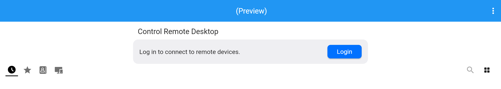
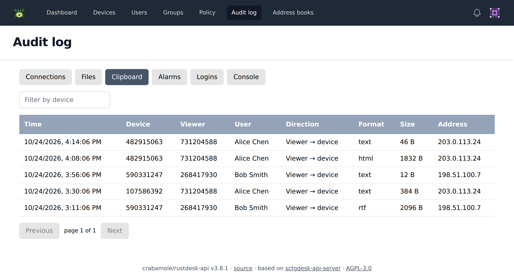
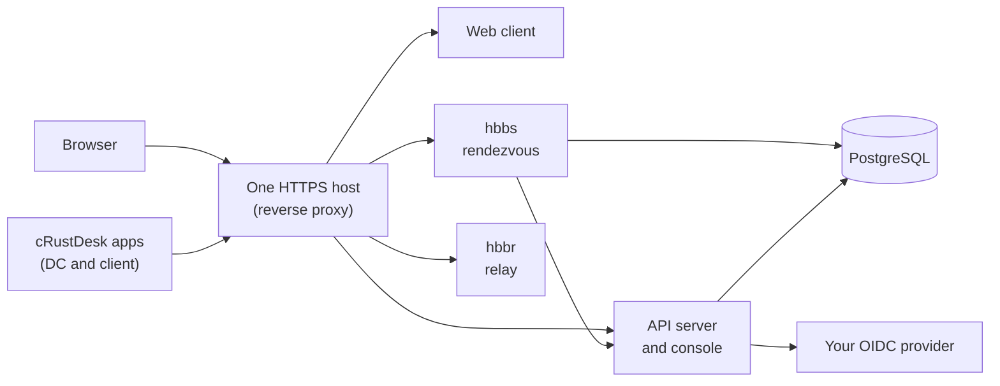

---
hide:
  - navigation
  - toc
---

# crabamole

**RustDesk as a Guacamole-style remote desktop: in the browser, behind your own single sign-on,
through one HTTPS host.**

[Deploy the server](https://github.com/crabamole/rustdesk-charts#readme){ .md-button .md-button--primary }
[Download the apps](https://github.com/crabamole/rustdesk/releases){ .md-button }

## What it adds to RustDesk

-   :material-web: **Web client**

    ---

    Connect to any device from a browser. The web client ships everything it loads, so it also
    runs on air-gapped networks.

-   :material-account-key: **Your single sign-on**

    ---

    Login through your OIDC provider only. No passwords are stored. Until the user signs in,
    the apps show a login button instead of the ID field.

-   :material-shield-lock: **One HTTPS host**

    ---

    The apps and the web client reach the server over WebSocket on port 443. No UDP, no public
    servers.

-   :material-monitor-lock: **Locked-down apps**

    ---

    One app, cRustDesk, in two variants: **DC** for managed devices, with data leaving the device
    locked down, and **client** for viewers, which connects out only. No public-server fallback,
    no auto-update.

-   :material-view-dashboard: **Web console**

    ---

    Users, groups, devices, address books, audit logs and one device policy, managed from the
    browser.

-   :material-kubernetes: **Kubernetes**

    ---

    A Helm chart deploys the server side: the rendezvous and relay servers, the API server and
    the web client.

## What it looks like

{ .shot }

The web client in a browser. Users log in through your identity provider before they can connect.

{ .shot }

The console's audit log. Each paste into a device is recorded with the viewer, the user, the format and the size; never the text.

## How it fits together

## Components

| Repo | What it is | Published as |
|---|---|---|
| [rustdesk](https://github.com/crabamole/rustdesk) | Web client and the cRustDesk apps for Windows, macOS and Linux | `ghcr.io/crabamole/rustdesk/web-client`, installers on [Releases](https://github.com/crabamole/rustdesk/releases) |
| [rustdesk-server](https://github.com/crabamole/rustdesk-server) | hbbs and hbbr with WebSocket registration and PostgreSQL | `ghcr.io/crabamole/rustdesk-server` |
| [rustdesk-api](https://github.com/crabamole/rustdesk-api) | API server and web console: OIDC login, users, groups, address books, audit logs | `ghcr.io/crabamole/rustdesk-api` |
| [rustdesk-charts](https://github.com/crabamole/rustdesk-charts) | Helm chart for the server side | `oci://ghcr.io/crabamole/charts/rustdesk` |
| [hbb_common](https://github.com/crabamole/hbb_common) | Library shared by the apps and the server | — |

## Relationship to RustDesk

crabamole is a fork of [RustDesk](https://github.com/rustdesk/rustdesk) and follows upstream
releases. It is not affiliated with the RustDesk project.

!!! warning "Misuse disclaimer"

    This project does not condone or support any unethical or illegal use of this software.
    Misuse, such as unauthorized access, control or invasion of privacy, is strictly against our
    guidelines. The authors are not responsible for any misuse of the application.
